<p align="center">
  
</p>

<p align="center">
  <a href="https://github.com/devxadarsh">
    
  </a>
  <a href="mailto:YOUR_EMAIL@example.com">
    
  </a>
  <a href="https://github.com/devxadarsh?tab=followers">
    
  </a>
  
</p>

<p align="center">
  
</p>

---

## 🚀 Engineering focus

I build **privacy-first, production-grade software** — Angular frontends, Java backends, and native
desktop applications architected to keep sensitive data on-device.

```bash
$ whoami
adarsh-pandey   ·  Software Engineer

$ primary
Java  ·  Angular  ·  TypeScript

$ also
Spring Boot  ·  Vert.x  ·  Microservices  ·  DevOps

$ status
Shipping  MeetVision AI  —  an on-device meeting copilot  (private repository)
```

---

## ⚡ Featured project

### 🎥 MeetVision AI — Meeting Overlay Assistant

**Private repository · featured by request.** Cross-platform desktop copilot for online meetings
(Zoom · Google Meet · Microsoft Teams).

<p align="center">
  
  
</p>

An assistant that listens to your meeting audio **entirely on-device**, shows what's being said in real
time, can read text from your shared screen, and produces concise, context-aware talking points **on
demand**. Its overlay stays **invisible during screen sharing**, so it's visible only to you — never to
other participants. Works with Zoom, Google Meet, Microsoft Teams, or any other meeting app.

**Supported platforms**

| Platform | Support |
|:--|:--|
| 🍎 **macOS** | macOS 14 and later — Apple Silicon & Intel |
| 🪟 **Windows** | Windows 10 / 11 — x64 |

**Features**

- 🎙️ **Live transcription** — see what's being said in real time.
- ⚡ **On-demand answers** — generate concise talking points for any moment with a single click.
- 👁️ **Screen reading** — optionally pull context from the content on your shared screen.
- 🫥 **Screen-share invisible** — the overlay is never shown to other participants when you share.
- 🔒 **Privacy-first** — audio is processed on-device and kept in memory, with local transcripts and offline support.
- 🧩 **Flexible overlay** — always-on-top, click-through, a detachable header, and global hotkeys.
- ✅ **No sign-in required** — fully self-contained and works without an account.

---

## 🛠 Tech stack

<p align="center">
  <b>Languages</b><br><br>
  
  
  
  
</p>

<p align="center">
  <b>Frontend</b><br><br>
  
  
  
  
  
</p>

<p align="center">
  <b>Backend &amp; Data</b><br><br>
  
  
  
  
  
  
</p>

<p align="center">
  <b>Desktop, Tooling &amp; DevOps</b><br><br>
  
  
  
  
  
  
</p>

---

## 📦 Selected work

| Project | What it is | Stack |
|:--|:--|:--|
| **⭐ MeetVision AI** | Meeting overlay assistant — on-device transcription, screen reading, on-demand talking points, invisible to screen share *(private)* | Cross-platform desktop app |
| [iPDFEditor](https://github.com/devxadarsh/ipdfeditor) | Angular-based PDF editor | Angular · pdf.js · pdf-lib |
| [Sai Enterprise Website](https://github.com/devxadarsh/sai-enterprise-website) | Enterprise marketing website | Angular |
| [Book Network](https://github.com/devxadarsh/Book-Network) | Book-network application | Java · Spring Boot |
| [Microservices Job App Demo](https://github.com/devxadarsh/microservices_job_app_demo) | Java microservices — gateway, config, discovery, service modules | Spring Cloud · Netflix OSS |
| [WhatsApp Clone](https://github.com/devxadarsh/whatsapp-clone) | WhatsApp-inspired messaging app | Angular |

---

## 🧭 Focus areas

- **Backend architecture** — microservices, gateways, service discovery, config servers, and clean hexagonal design.
- **Web applications** — Angular with signals, standalone components, and a strong focus on UX.
- **Desktop & native** — Electron apps that talk to on-device ML/OCR runtimes on macOS and Windows.
- **Developer tooling & DevOps** — build pipelines, packaging, and automation that keep shipping smooth.

---

## 📊 GitHub analytics

<p align="center">
  
</p>

<p align="center">
  
  
</p>

<p align="center">
  
  
</p>

<p align="center">
  
</p>

---

## 🤝 Let's connect

I'm always interested in learning, sharing ideas, and collaborating on useful software.

<p align="center">
  <a href="https://github.com/devxadarsh">
    
  </a>
  <a href="mailto:YOUR_EMAIL@example.com">
    
  </a>
</p>

<p align="center">
  
</p>
