<p align="center">
  
</p>

<p align="center">
  <a href="https://github.com/devxadarsh">
    
  </a>
  <a href="mailto:devxadarsh@gmail.com">
    
  </a>
  <a href="https://github.com/devxadarsh?tab=followers">
    
  </a>
  
</p>

<p align="center">
  
</p>

<p align="center">
  
</p>

## 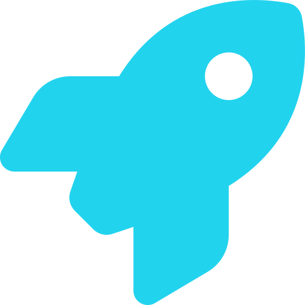 Engineering focus

I build **privacy-first, production-grade fintech software** — Angular frontends, Java backends, and
native desktop applications, with a focus on secure, high-availability transaction systems.

```bash
$ whoami
adarsh-pandey   ·  Software Engineer

$ primary
Java  ·  Angular  ·  TypeScript

$ domain
Core Banking (CBS)  ·  Payment Gateways  ·  Microservices

$ security
Spring Security  ·  JWT  ·  OAuth2  ·  API Gateway

$ also
Spring Boot  ·  Vert.x  ·  Spring Cloud  ·  AWS  ·  DevOps

$ status
Shipping  iPDFEditor  —  privacy-first, client-side PDF studio  (live)
Also      MeetVision AI  —  on-device meeting copilot  (private repository)
```

<p align="center">
  
</p>

##  Fintech domain expertise

- **Core Banking (CBS)** — secure account, loan, and locker workflows for banking and microfinance platforms.
- **Payment gateways** — omnichannel acceptance and transaction flows across UPI, cards, wallets, and net-banking.
- **Compliance-aware engineering** — building to RBI-licensed payment aggregator standards with auditable, secure workflows.
- **Banking modules** — Loan Origination (LOS), Locker Management, Insta ATM, and real-time card issuance.
- **Transaction processing** — high-volume reporting, EOD/monthly/yearly batch schedulers, and resilient async pipelines.
- **Security architecture** — authentication, authorization, token lifecycles, and gateway-level protection.

<p align="center">
  
</p>

## 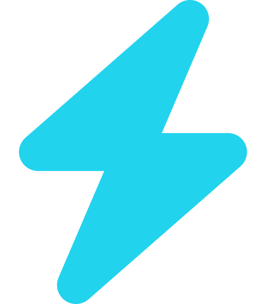 Featured projects

###  MeetVision AI — Meeting Overlay Assistant

**Private repository · featured by request.** Cross-platform desktop copilot for online meetings
(Zoom · Google Meet · Microsoft Teams).

<p align="center">
  
  
</p>

An assistant that listens to your meeting audio **entirely on-device**, shows what's being said in real
time, can read text from your shared screen, and produces concise, context-aware talking points **on
demand**. Its overlay stays **invisible during screen sharing**, so it's visible only to you — never to
other participants. Works with Zoom, Google Meet, Microsoft Teams, or any other meeting app.

**Supported platforms**

| Platform | Support |
|:--|:--|
| 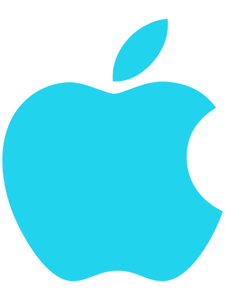 **macOS** | macOS 14 and later — Apple Silicon & Intel |
| 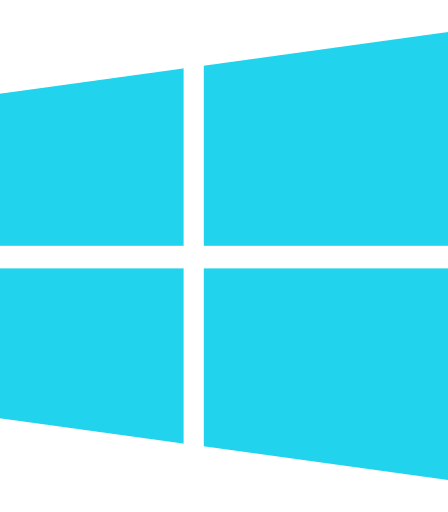 **Windows** | Windows 10 / 11 — x64 |

**Features**

-  **Live transcription** — see what's being said in real time.
-  **On-demand answers** — generate concise talking points for any moment with a single click.
- 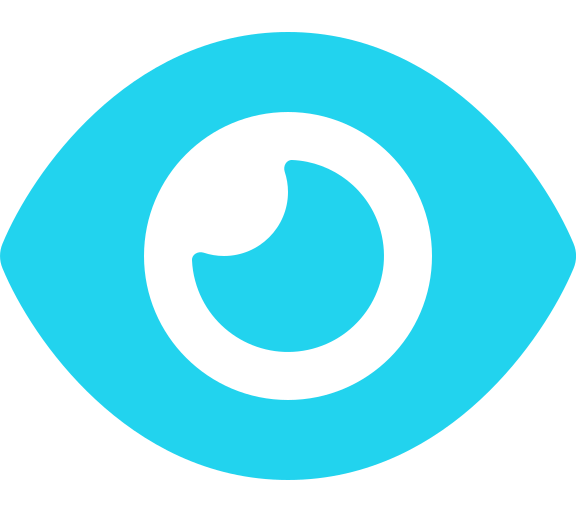 **Screen reading** — optionally pull context from the content on your shared screen.
- 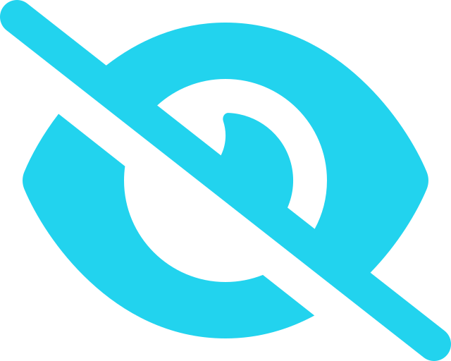 **Screen-share invisible** — the overlay is never shown to other participants when you share.
-  **Privacy-first** — audio is processed on-device and kept in memory, with local transcripts and offline support.
-  **Flexible overlay** — always-on-top, click-through, a detachable header, and global hotkeys.
- 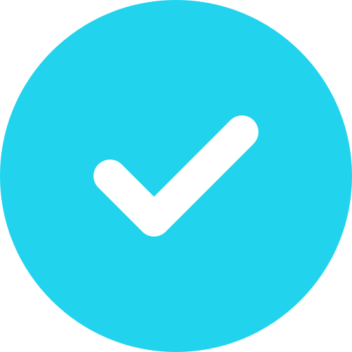 **No sign-in required** — fully self-contained and works without an account.

<p align="center">
  
</p>

###  iPDFEditor — Privacy-First PDF Studio

**Live:** [ipdfeditor.pages.dev](https://ipdfeditor.pages.dev/) · **Source:** [github.com/devxadarsh/ipdfeditor](https://github.com/devxadarsh/ipdfeditor)

A browser-based PDF studio where documents are opened, edited, and exported **entirely on-device**.
WebAssembly engines run in the browser sandbox, so files are never uploaded, queued on a server, or
stored in the cloud.

**Core capabilities**

- 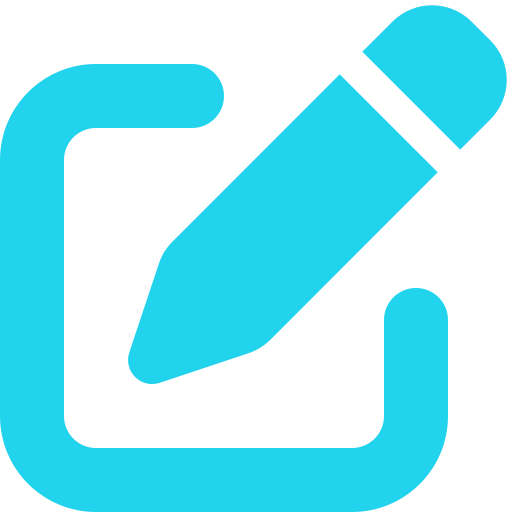 **Editing & annotation** — text editing, highlights, shapes, freehand drawing, and reusable signatures.
-  **Document tools** — merge, split, compress, and convert PDFs.
- 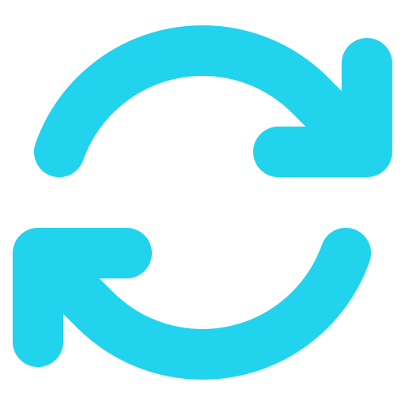 **Conversions** — PDF ↔ Word, JPG → PDF, PDF → JPG, and PDF → text.
- 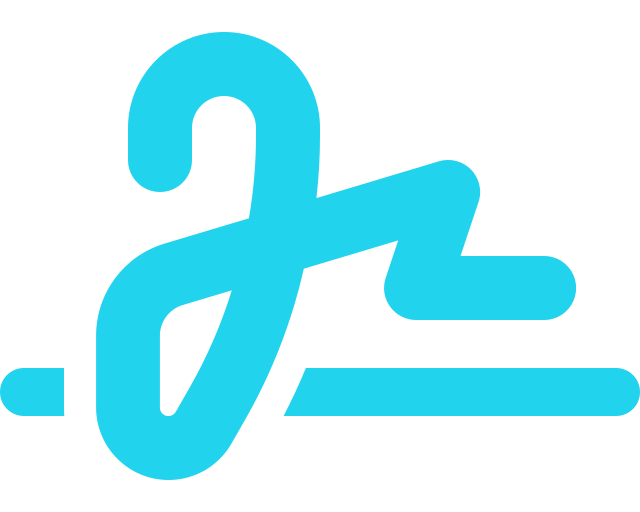 **Signatures & verification** — create or upload signatures, verify signed documents, and inspect PDF forensics.
-  **Metadata inspector** — view, edit, and audit document metadata.
- 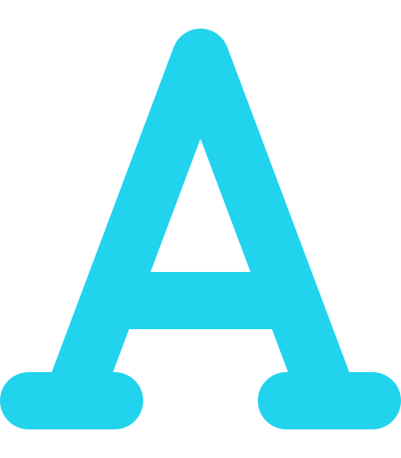 **On-device OCR** — text extraction with Tesseract.js, with no cloud calls.
-  **Local WASM engine** — MuPDF and qpdf compiled to WebAssembly, running in Web Workers with `pdf-lib` for export.
-  **Offline & installable** — PWA support with recent documents persisted in IndexedDB.
- 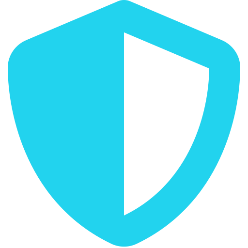 **Privacy by design** — zero uploads, zero accounts, and all processing inside the browser sandbox.

**Stack:** Angular 22 (standalone components + signals) · Fabric.js · pdf-lib · MuPDF · qpdf-wasm · Tesseract.js · IndexedDB · Cloudflare Pages

<p align="center">
  
</p>

## 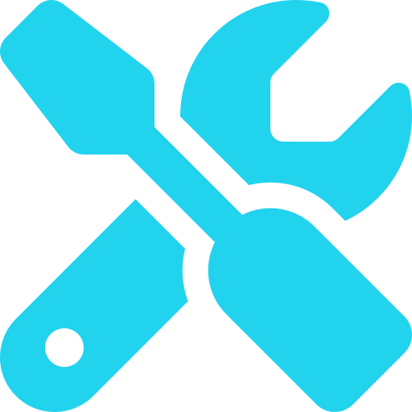 Tech stack

<p align="center">
  <b>Languages</b><br><br>
  
  
  
  
</p>

<p align="center">
  <b>Frontend</b><br><br>
  
  
  
  
  
  
</p>

<p align="center">
  <b>Backend &amp; Data</b><br><br>
  
  
  
  
  
  
  
  
  
  
  
  
  
  
  
  
  
  
</p>

<p align="center">
  <b>Cloud, Tooling &amp; DevOps</b><br><br>
  
  
  
  
  
  
  
  
  
  
  
</p>

<p align="center">
  
</p>

## 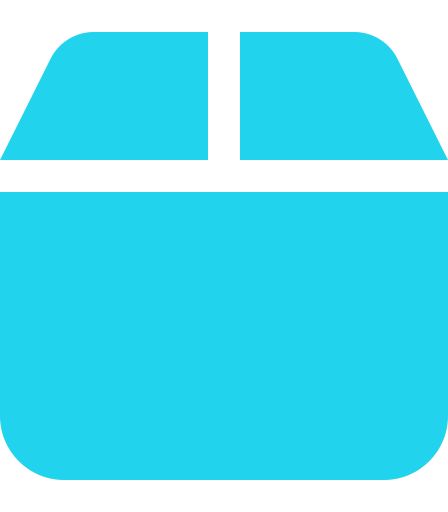 Selected work

| Project | What it is | Stack |
|:--|:--|:--|
|  **MeetVision AI** | Meeting overlay assistant — on-device transcription, screen reading, on-demand talking points, invisible to screen share *(private)* | Cross-platform desktop app |
|  [iPDFEditor](https://github.com/devxadarsh/ipdfeditor) | Privacy-first, client-side PDF studio — edit, merge, split, compress, convert, sign, OCR, and inspect PDFs in the browser *(live at ipdfeditor.pages.dev)* | Angular 22 · Fabric.js · WASM (MuPDF, qpdf) · pdf-lib · Tesseract.js |
| [Sai Enterprise Website](https://github.com/devxadarsh/sai-enterprise-website) | Enterprise marketing website | Angular |
| [Book Network](https://github.com/devxadarsh/Book-Network) | Book-network application | Java · Spring Boot |
| [Microservices Job App Demo](https://github.com/devxadarsh/microservices_job_app_demo) | Java microservices — gateway, config, discovery, service modules | Spring Cloud · Netflix OSS |
| [WhatsApp Clone](https://github.com/devxadarsh/whatsapp-clone) | WhatsApp-inspired messaging app | Angular |

<p align="center">
  
</p>

## 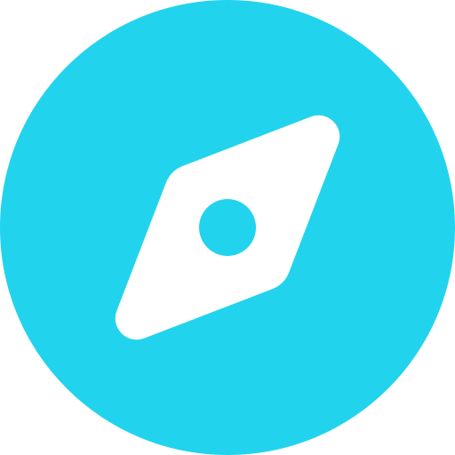 Focus areas

- **Fintech platforms** — core banking, payment gateways, and compliance-aware transaction systems.
- **Backend architecture** — microservices, gateways, service discovery, config servers, and clean hexagonal design.
- **Web applications** — Angular with signals, standalone components, and a strong focus on UX.
- **Desktop & native** — Electron apps that talk to on-device ML/OCR runtimes on macOS and Windows.
- **Developer tooling & DevOps** — build pipelines, packaging, and automation that keep shipping smooth.

<p align="center">
  
</p>

## 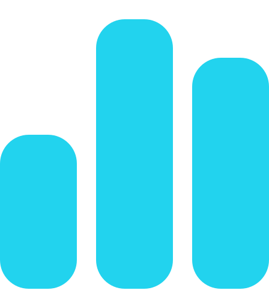 GitHub analytics

<p align="center">
  
</p>

<p align="center">
  
  
</p>

<p align="center">
  
  
</p>

<p align="center">
  
</p>

## 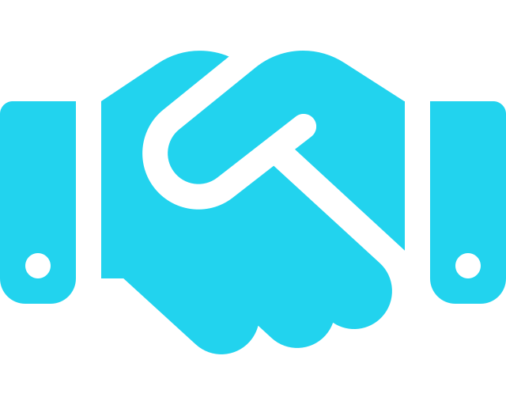 Let's connect

I'm always interested in learning, sharing ideas, and collaborating on useful software.

<p align="center">
  <a href="https://github.com/devxadarsh">
    
  </a>
  <a href="mailto:devxadarsh@gmail.com">
    
  </a>
</p>

<p align="center">
  
</p>
